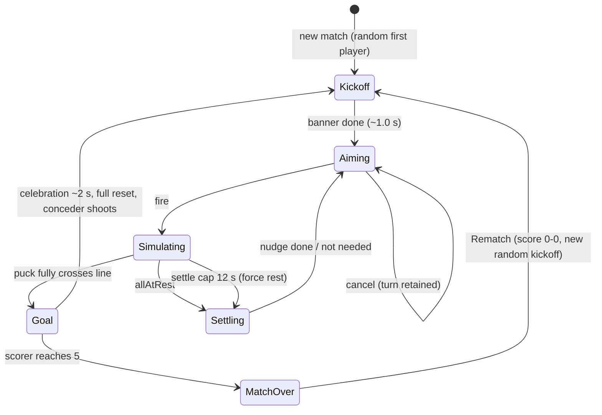

# Puck Puck Go — Engineering Design Document

Nov 9, 2026 · responds to `Puck Puck Go PRD.md` (commit `8e4b995`)
Status: implemented (v1 as specified, two playtest iterations in) · verification ladder §14, as-built status §17 · M4/M5 device checks outstanding

---

## 0. How to read this document

This is the engineering response to the PRD. It answers four questions in order:

1. **What changed in the requirements** because the use context is a *stationary* car during an EV charge, not a moving one (§2).
2. **What we decided** and why, especially the one substantive technical fork: vendored Planck.js vs. a purpose-built circle solver (§3).
3. **How it is built** — architecture, geometry, solver, input, rendering, platform plumbing (§4–§12).
4. **How we know it works** — derivations that show the PRD's constants can pass its own acceptance criteria, plus a traceability matrix and self-test harness (§13–§15).

Everything numeric in §13 is derived analytically from the PRD's own constants, so it is a *prediction* to be confirmed on device, not a measurement.

---

## 1. System at a glance

One artifact: `index.html`. Opens from local storage, no network, no build step, no persistence.

| Property | Value |
| --- | --- |
| Bodies | 11 (10 stones, 1 puck). All circles. |
| Simulation | Fixed timestep 1/120 s, speed-adaptive sub-stepping, closed-form drag |
| World units | Field height `H = 1.0`. Field spans x ∈ [−0.8, 0.8], y ∈ [−0.5, 0.5] |
| Render | Canvas 2D, DPR-scaled, cached static layer |
| Input | Pointer Events, single captured pointer per aim, quantized to a lattice |
| Audio | Web Audio, synthesized, unlocked on first `pointerdown` |
| Size target | ≲ 120 KB uncompressed, no dependencies |

---

## 2. Context correction: stationary car, on charge

The PRD repeatedly assumes motion: "aiming that works reliably on a touchscreen **in a moving car**", "so **a bump in the road** doesn't waste my turn", "no accidental shot that couldn't be cancelled", felt-table drag on a device that may be jostled. The corrected context is **two players, tablet mounted or propped, car in Park, engine off, tablet charging**.

This is not a cosmetic edit. It removes one entire class of engineering effort and adds another.

### 2.1 Requirements we de-prioritize or drop

| PRD assumption | Status | Engineering consequence |
| --- | --- | --- |
| Device is subject to road vibration/acceleration | **Invalid** | No pointer-position low-pass filter. No jitter-tolerant "power hysteresis". No re-anchoring of the aim origin when the device translates. No debounce on `pointerup` spikes. |
| Accidental shots come from bumps | **Invalid** | The cancel mechanic **stays**, but its justification changes to *aim overshoot and mis-grabs*, which remain the dominant failure mode. Dead zone can be small. |
| Players may be standing/reaching unstably | **Weakened** | Reach is bounded by seatbelts and the console, not by balance. Drag distance budget is a comfort limit, not a stability limit (§8.4). |
| Physics must tolerate a tilted, shifting device | **Invalid** | The device is on a mount. Still: **do not add device-orientation input** (§8.6). Mount angle varies per car and per mount; the game table is top-down by design. |

Estimated saving: ~200 LOC of input hardening we would otherwise have written, and one source of non-determinism removed for free.

### 2.2 Requirements we add or strengthen

**(a) Capacitive ghost touches from charging — new, and the most important change.**
Charging a tablet from a car's 12 V USB port or an inverter-fed outlet is a known source of capacitive-screen noise: phantom pointer events, coordinate jumps, and spurious drags. This risk is *created* by the corrected context. Design response:

1. Exactly one pointer owns an aim, identified by `pointerId` at `pointerdown`. All other `pointerdown` events are ignored until that pointer is released — this is already PRD rule 6, and it happens to be the right mitigation.
2. A shot **cannot** fire unless the pointer has traveled past the cancel dead zone. Therefore a phantom tap, however it arrives, is inert by construction. This invariant must not be weakened by later tuning.
3. No coordinate smoothing (§2.1) — but a captured pointer whose position jumps discontinuously is still tracked; we do not try to "repair" it, because the dead-zone rule already bounds the damage to at most a bad shot by the correct player.
4. Ghost pointers are harmless during `Simulating`/`Goal`/`Match over` because input is locked there.

Worst residual case, documented deliberately: a ghost `pointerdown` arriving *just before* a real one steals the aim slot, so the real finger is ignored for that attempt; it releases with no travel → cancel → turn retained → the player re-taps. One wasted tap, no lost turn. Accepted.

**(b) High ambient light and thermally-imposed display dimming.**
A car cabin in sunlight plus a charging tablet is the worst-case reading environment on either platform: auto-brightness maxes out, and both iOS and Android dim the panel to manage heat. Consequence: **the PRD's "subtle glow" turn indicator must never be the only signal.** Redundant channels are mandatory (§10.4). Contrast is a functional requirement, not styling.

**(c) Thermal throttling is the real threat to the 60 fps budget.**
A 2022 mid-range Android tablet in a warm cabin, charging, running a canvas render loop, will throttle. The render path must be cheap with headroom, not merely "not obviously slow": cached static layer, pre-baked sprites, no `shadowBlur`, no per-frame gradients, capped particle count (§10.2).

**(d) Sessions are interrupted by the car, not by jostling.**
Charging finishes, someone opens a door, the OS sleeps the panel, the driver's display or a charging app takes focus. There is no pause and no persistence (PRD non-goals), so:
- On `visibilitychange` (hidden) and `window.blur`: release pointer capture, cancel any aim in flight, stop audio.
- The frame loop must clamp its accumulator so returning after 3 minutes of sleep resumes exactly where it left off, with no catch-up explosion (§11.3).
- No timers, no auto-forfeit. The match simply waits.

**(e) Screen wake is a live problem even though the tablet is plugged in.**
Being on charge does not prevent auto-lock on iPadOS, and cannot be assumed to on Android. The Wake Lock API stays, with caveats that must be verified empirically on device (§11.4) rather than assumed — including that it requires a secure context and a visible page, and `file://` handling differs between Chrome for Android and Safari opening a file from the Files app.

### 2.3 Net effect on the acceptance criteria

No PRD acceptance criterion is relaxed. Two get cheaper ("stones never enter a goal at any launch speed" needs no motion-induced-input confound during testing), and three get harder in practice: 60 fps under thermal load, sounds after first touch (unchanged), and "no playtest session ended by an accidental shot" (now driven by charge-noise ghosts and gloved/one-handed taps rather than bumps).

### 2.4 PRD text deltas requested

| PRD location | Current | Proposed |
| --- | --- | --- |
| Goals §2 | "aiming that works reliably on a touchscreen in a moving car" | "…on a touchscreen mounted in a stationary, charging vehicle" |
| User story | "so a bump in the road doesn't waste my turn" | "so an overshoot or mis-grab doesn't waste my turn" |
| Physics § | (implied level device) | add: "no device-orientation or in-plane gravity input; the table is top-down regardless of mount angle" |
| Non-goals | — | add: "robustness to capacitive touch noise is in scope; pointer jitter *filtering* is not" |
| UI §"rotate to landscape" | landscape-only; portrait dims the canvas and shows a rotate prompt | "the table follows the window: its long axis points whichever way draws the bigger board. Play is blocked only when the rendered stones fall below the legibility floor — a big portrait panel is a bigger board than a small landscape one" (§10.5, D11) |

---

## 3. Decision register

| # | Decision | Choice | Rejected alternative | Why |
| --- | --- | --- | --- | --- |
| D1 | Physics engine | **Purpose-built circle solver**, isolated behind a `Sim` facade | Vendor Planck.js inline | See §3.1 |
| D2 | Units | Simulate in field-height units (`H = 1`), scale only at render | Simulate in pixels | PRD constants are already in `H`; makes feel resolution- and DPR-independent; keeps constants at O(1) for solver conditioning |
| D3 | Field boundary representation | **Signed-distance field** (rounded box ∪ goal pockets) | Segment + arc primitive soup | Three lines of math, analytic normals, walls are provably *thick*, one code path handles corners and mouth posts |
| D4 | Integrator | Closed-form drag + exact position update, fixed 1/120 s | Semi-implicit Euler | Unconditionally stable, and makes §13's settle predictions exact rather than approximate |
| D5 | Render/sim coupling | **No interpolation**: render *is* the sim state | Interpolate between fixed steps | 120 Hz sim ≥ 60 Hz display means ≥ 1 step per frame always; removes state aliasing between aim input and what is drawn |
| D6 | Input determinism | Quantize launch angle (0.05°) and power (0.4%) to a lattice | Raw floats | Makes "same shot → same result" true as a *human* test, not just a same-bits tautology |
| D7 | Script structure | One inline classic `<script>` with section banners + small namespaces | ES modules | Inline `import` cannot resolve from `file://`; modules buy nothing in one file |
| D8 | Static rendering | Offscreen canvas, redrawn only on resize | Redraw field each frame | Biggest single lever for the throttled-tablet budget |
| D9 | Wake lock | Opportunistic + re-acquire on visibility; treat absence as acceptable | Depend on it | Support on iPadOS `file://` is unverified; §11.4 |
| D10 | Turn indicator | Glow **plus** banner, stone ring, and score tint | PRD's glow alone | Sunlight/dimmed-panel redundancy (§2.2b) |
| D11 | Board orientation | **Layout is a display property**: `wide` / `tall` / `auto` picks the layout that draws the bigger board; the legibility floor, not the viewport shape, gates play | "Landscape only" + `screen.orientation.lock('landscape')` | A 768×1024 portrait panel draws the *same* 573 px board as a 1024×768 landscape one — landscape was never the requirement, an aimable stone was. And no browser can sense where the two players are sitting, so the layout is chosen from measured room and overridable by hand (§10.5) |

### 3.1 D1 in detail: why not Planck.js

The PRD prefers Planck for continuous collision detection. That preference was made before the physics surface was pinned down. Once it is, Planck's remaining advantage is small and its costs are concrete:

**Against (evidence from the PRD's own requirements):**
- "All bodies are circles. Disable rotation effects. Set inter-body friction to 0." That deletes rotation integration, friction impulse generation, manifold clipping, and most of the contact solver's complexity — the bulk of the library.
- 11 bodies. No broadphase needed (55 pair tests per substep, brute force).
- The PRD's drag model (constant deceleration + linear damping + snap-to-zero) **is not a Planck feature**. It has to be written by hand as per-step impulses regardless of engine.
- The PRD demands bit-determinism for a scripted 1,000-shot test. An ~800-line auditable solver gives that trivially; a vendored solver requires trusting a black box and reading its TOI code to explain a failure.
- "Bundled inline" means vendoring a file we do not control, grown by a copy/paste step into an already large single HTML, with no build step to do it for us. (Load/parse of a several-hundred-KB script on a throttled 2022 tablet is a real, measurable cost on a slow in-car cold start.)
- The single hardest tunable, restitution, is per-pair-type in the PRD (0.92 body-body, 0.75 body-wall). Trivial in our solver; fiddlier in a joint/fixture-based setup.

**For:** Planck's TOI is battle-tested, and if our CCD reasoning is wrong, theirs is probably right.

**Resolution — D1 with an escape hatch.** Implement the circle solver, but put *everything* the game talks to behind a narrow facade so a swap is local (target: no call site outside the `SOLVER`/`SIM` sections knows which engine is active):

```js
// The entire engine boundary. Nothing else may touch physics internals.
Sim.create(cfg)            -> world
world.addStone(x, y)       -> bodyId
world.addPuck(x, y)        -> bodyId
world.resetToLayout(layout)-> void
world.impulse(bodyId, vx, vy)
world.step(dt)             -> void     // advances one 1/120 s base step
world.state()              -> [{id,x,y,vx,vy,resting}]
world.query()              -> { allAtRest, maxSpeed, contacts, outOfBounds[] }
```

**Decision gate (end of M2):** if the solver fails either (i) the 1,000-shot zero-tunneling test, or (ii) pileup stability (visible sinking, jitter, or popping of a 3-body chain) with 4+ relaxation iterations, we vendor Planck behind the same facade and re-implement drag, the SDF walls, and goal detection as Planck fixtures. Budget +0.5 day for that branch. The risk that this hedges — tunneling — is exactly the PRD's top acceptance criterion, so hedging it is correct even though we expect not to use the hatch.

---

## 4. Delivery format and file layout

**Hard constraints from the PRD** (`index.html`, offline from local storage, no build step) plus one hard constraint the PRD does not state: **ES module `import` does not work from `file://`** (CORS blocks the fetch of the imported module). A single inline `<script type="module">` with no imports is legal, but pointless here. So: **one inline classic script**, ordered sections, IIFE-scoped namespaces.

```
index.html
  <head>  viewport meta (viewport-fit=cover, no user scaling), inline CSS,
          gesture-suppression rules
  <body>  <canvas id="stage">, <div id="rotate-prompt">, <div id="debug">
  <script>  /* one classic script, sections in load order */
    ┌─ CONFIG      PHYSICS, FIELD, AIM, RENDER, AUDIO, DEBUG      (~90 LOC)
    ├─ GEOMETRY    field SDF, layouts, extents                    (~90)
    ├─ SOLVER      bodies, contacts, impulses, positional corr.   (~230)
    ├─ SIM         facade, drag, step policy, rest, goals, nudge  (~260)
    ├─ GAME        match model, state machine, turn/turn-order    (~200)
    ├─ INPUT       pointer capture, aim math, quantize, cancel    (~180)
    ├─ RENDER      fit, static layer, sprites, indicator, FX, HUD (~380)
    ├─ AUDIO       context, 4 voices, pair throttle, unlock       (~140)
    ├─ PLATFORM    fullscreen, orientation, wake lock, gestures,  (~150)
    │              visibility, resize
    ├─ DEBUG       overlay, sliders, self-tests                   (~220)
    └─ BOOT        wire-up, rAF loop                              (~80)
                          total ≈ 2,000 LOC, no dependencies
```

Load order matters and is the only "module system": each section exports exactly one object into a single `PPG` namespace; a section may depend only on sections above it. `GAME` never calls `RENDER` or `AUDIO` directly — it emits events (`onGoal`, `onTurnStart`, `onShotFired`) that `BOOT` fans out. This keeps the PRD's "tuning and fixes stay local" requirement enforceable, and keeps the D1 escape hatch cheap (only `SIM`+`SOLVER` change on an engine swap).

No external fonts, no images, no fetch, no analytics, no service worker.

---

## 5. Coordinate system, units, and fit

**World space** (H units, y down for render parity? — no: **y up**, screen flip done once in `RENDER`):

```
x ∈ [−0.80, +0.80]   field interior (1.6 H × 1.0 H)
y ∈ [−0.50, +0.50]
P1 defends x = −0.80, P2 defends x = +0.80
```

**Fit**: the *drawable* extents include both goal pockets: x ∈ [−0.88, +0.88] → aspect **1.76 : 1**
in `wide`, and the same box turned 90° in `tall` (§10.5).

```
layout = 'wide' | 'tall' | 'auto'                 // which way the table's LONG axis points
mx = 8 px + max(inset-left, inset-right)          // insets PER AXIS: a notch is on one edge,
my = 8 px + max(inset-top,  inset-bottom)         // and which edge depends on how it is turned
band   = clamp(shortSide * 0.10, 34 px, 72 px)    // scoreboard strip, reserved not overlaid
availW = W − 2*mx − (tall ? band : 0)             // strip across the top when wide,
availH = H − 2*my − (wide ? band : 0)             // down the left edge when tall
scale  = min(availW / (tall ? 1.00 : 1.76), availH / (tall ? 1.76 : 1.00))
auto   = tall  if  scale(tall) > scale(wide) * 1.06  else  wide      // flipMargin
```

Every world→screen mapping goes through one function, `pt(x, y)`, with `toWorld`, `dir` and `rect` as
its companions. `wide` maps screen x ← world x, screen y ← −world y; `tall` swaps the axes and flips
one: screen x ← −world y, screen y ← −world x. That is not a cosmetic refactor: a rotated board needs
two screen axes to describe one world point, and the old `X(x)` / `Y(y)` pair could not. The input
layer measures the pull against `pt()` — *where the stone is drawn* — so "you grab what you see"
holds in both layouts by construction rather than by two copies of the arithmetic (§8.1).

Fitting the pockets rather than clipping them means the goal is fully drawn, and the letterbox never hides gameplay. The score is **not** drawn on top of the felt: it owns a reserved strip — across the top in `wide`, down the left edge in `tall` — and the field is laid out in what is left, so the play area is the viewport minus the scoreboard on every panel in either layout. A strip is *reserved* rather than the letterbox being *relied on* because most landscape tablets are 16:9 or wider, where there is no spare vertical band to hide a score in — the first build put the digits on the felt for exactly that reason, and playtest called it. `T26` now pins both halves: the HUD box must end above the field's top edge, and `fieldH ≤ viewport − 2·margin − band`.

Measured, at `1024×768` and at `768×1024` with `layout: auto`: `scale` is **572.7 px/H** in *both* — 51.5 px stones either way (`T27`). Turning the tablet costs nothing; it changes the seat, not the board. That equality is the point of D11, and it is a measured property, not an expectation.

Derived physical sizes (consequence for §8's touch targets, computed for two representative tablets):

| | iPad 10.9" landscape (1024×768 CSS) | Android 10.4" (1333×800 CSS) |
| --- | --- | --- |
| Field height in CSS px | ≈ 691 | ≈ 720 |
| Stone radius / diameter | 31 / 62 px ≈ 1.5 cm | 32 / 65 px ≈ 1.1 cm |
| Puck diameter | 48 px | 50 px |
| Max drag (0.25 H) | ≈ 173 px ≈ 4.2 cm | ≈ 180 px ≈ 2.9 cm |

Two takeaways: the max drag distance (2.9–4.2 cm of finger travel) is comfortable for a seatbelted arm, so **keep 0.25 H**; and stone diameter varies ~40% between target tablets, so touch tolerance must scale with the rendered stone radius, not be a fixed pixel constant (§8.1).

---

## 6. Field geometry

### 6.1 Composition

- Rounded rectangle: half-extents (0.80, 0.50), corner radius **R = 0.12**.
- Goal mouth on each end wall: |y| ≤ **0.15** (width 0.30), centered.
- Goal pocket: x ∈ [0.80, 0.88] (depth 0.08), |y| ≤ 0.15, closed back and sides.

Feasibility check, since the PRD fixes both mouth width and corner radius:
`straight end-wall length = 0.50 − 0.12 = 0.38` half-height → 0.76 total; mouth 0.30 leaves **0.23 of straight wall on each side of the mouth**. Legal, but the mouth posts at (0.80, ±0.15) are sharp 90° vertices — see Q2 in §16.

### 6.2 Boundary as two signed-distance functions (D3)

The PRD rule "the goal mouth acts as a wall for stones and an opening for the puck" is implemented as **two regions**, not one region plus special cases:

```js
// rounded-box SDF: box inset by R, ⊕ disk(R). Analytic gradient = inward normal.
function sdRoundedBox(p, half, R) {
  const q = vec2(|p.x| - half.x + R, |p.y| - half.y + R);
  return min(max(q.x, q.y), 0) + length(vec2(max(q.x,0), max(q.y,0))) - R;
}
// SDF of one goal pocket (a box behind the mouth)
function sdPocket(p, side) { ... }

STONES: d(p) = sdRoundedBox(p, (0.80, 0.50), 0.12)            // mouth is SOLID wall
PUCK:   d(p) = min(sdRoundedBox(...), sdPocket(p,+1), sdPocket(p,−1))   // mouth OPEN
```

A body is inside when `d(center) ≤ radius`; contact depth is `radius − d(center)`, contact normal is `−∇d(center)` (outward). Everything else follows from this:

- **Corners**: handled by the same formula. Concave fillet contact falls out of the SDF; no arc-specific code.
- **Stones can never reach the pocket**: the stone region's boundary is solid for all x > 0.80. This is the structural reason the PRD criterion "stones never enter a goal, at any launch speed" is satisfiable — the pocket simply is not part of the space a stone inhabits (see §15, test T1, for how we prove it empirically).
- **Walls are thick**: the outside of each SDF is a solid half-space-ish volume, never a thin shell, so "tunneling through a wall" requires displacing a body through ≥ 0.08 H of solid (pocket back wall). The sub-step bound in §7.3 guarantees ≪ that.
- **Puck scoring** (§7.6) is a region test, not a line-crossing test.

Why not segments + arcs: it needs ~10 primitives with tangent-point bookkeeping, three contact cases (segment, arc-concave, vertex), and the pocket opening must be carved by *removing* a sub-segment — a special case that then has to be maintained separately for the two body classes. The SDF expresses the two-region rule in one line.

---

## 7. Physics

### 7.1 What is on the board

11 bodies, all circles, no rotation, no angular velocity in any form, no inter-body friction (PRD). Consequence worth stating plainly: **every contact is a 1-D impulse along one normal.** There is no tangential impulse anywhere in the system, and no angular momentum to conserve. That is the single biggest simplification of the solver.

### 7.2 One base step = 1/120 s, with sub-steps

```
baseStep(dt = 1/120):
  vMax = max over all bodies of |v|
  nSub = clamp(ceil(2 * vMax * dt / MAX_TRAVEL), 1, 8)     // MAX_TRAVEL = 0.02 H
  for i in 1..nSub: subStep(dt / nSub)

subStep(h):
  1. integrate(drag + exact position update)      // §7.4
  2. collideBodyBoundary(body, regionFor(body))   // SDF, §6.2
  3. collidePairs(brute force, 55 pairs)          // circle-circle
  4. solveContacts(iterations = 4)                // §7.5
  5. positionalCorrection(factor = 0.4, slop = 0.0005)
  6. clamp |v| ≤ HARD_SPEED_MAX (6.0 H/s)
  7. restTest(body): if |v| < REST_THRESHOLD → v = 0, resting = true
```

`2 * vMax` is the worst-case *relative* approach speed of a pair. With `vMax = 3.6` (§13.2 bound): `nSub = ceil(2*3.6*0.00833/0.02) = 3`. Cost at 120 Hz: 120 × 3 × 55 ≈ 20k circle-circle tests/s and ~35k SDF evaluations/s — two orders of magnitude below budget on a throttled tablet. `MAX_TRAVEL = 0.02 H` is 0.57 of the puck radius and 0.44 of the stone radius, so no pair can pass through another, and no body can cross a wall undetected, without the cap being hit.

The `nSub = 8` cap exists so a pathological state cannot drop the frame rate; at the cap, bodies move ≤ 0.06 H/step, still far less than the smallest solid feature.

**No rotation** means no need for the PRD's concern about spin-dependent ricochets; bank-shot predictability (§13.5) is a pure geometric consequence.

### 7.3 CCD strategy: bounded sub-stepping, plus one belt

The PRD asks for no tunneling. We do not implement a swept-toi solver. Instead:

1. **Bound the motion per sub-step** (`MAX_TRAVEL`), as above. Because every obstacle is either a circle of radius ≥ 0.035 or a solid region ≥ 0.08 thick, displacement ≪ min feature size ⇒ a discrete overlap test is guaranteed to fire. This is the same argument Box2D's continuous step relies on, but with the bound stated up front and checkable.
2. **Belt**: for any pair whose relative displacement in this sub-step exceeds `0.5 * (rA + rB)`, do an explicit swept-circle test (quadratic in time, ~15 lines) and resolve at the earliest time of impact. This branch should be dead code in practice; we implement it anyway and have the debug overlay count hits so we can *see* whether our bound is holding rather than trusting it.
3. **Invariant asserted every step in debug**: `d(center) ≤ radius + SLOP` for every body in its own region. A violation is a tunneling bug, reported with position/velocity/step index. This converts the PRD's hardest criterion from "look really carefully at 1,000 shots" into a boolean the harness can fail on.

### 7.4 Drag model — closed form (D4)

PRD model: constant rolling deceleration `a`, linear damping `k`, rest threshold. ODE along the velocity direction:

```
dv/dt = −a − k v        ⇒   v(h) = (v0 + a/k)·e^(−k h) − a/k
                          ⇒   Δx  = (v0 − v(h))/k − (a/k)·h     (k → 0: Δx = v0 h − ½a h²)
```

Implementation notes:
- Vector form: operate on the velocity vector's magnitude, rotate nothing. `v ← v̂ · max(0, v(t))`; if the result ≤ 0, `v = 0`.
- `k = 0` and `a = 0` must be supported (the debug sliders go to zero) — guard both branches.
- This is exact for any `h`, so sub-stepping does not perturb settle behavior, and **the settle predictions in §13.1 are not approximations** — they are what the code computes. That is the whole reason for D4; Euler would put our tuning table and our implementation in a slow argument with each other.
- Snap-to-rest at `REST_THRESHOLD` makes "all bodies at rest" a *decidable*, exactly-zero condition rather than a fuzzy epsilon race.

### 7.5 Contact resolution

Sequential impulses, 4 iterations, normal-only (no friction per PRD), restitution applied only above a relative approach speed of 0.2 H/s (below that, restitution off → no micro-bounce jitter as bodies settle; this is the standard Box2D velocity-threshold trick and it is what lets the rest threshold ever be reached).

Restitution is looked up by pair type in one table, satisfying the PRD's three constants in one place:

```js
RESTITUTION = { 'stone-stone': 0.92, 'stone-puck': 0.92, 'wall-any': 0.75 }
```

Positional correction is **position-only** (project out of overlap; do not touch velocity). Position projection with slop adds no energy, cannot create a jitter cycle in a 3-body chain pressed against a wall, and with slop 0.0005 H (≈ 0.35 px at our scale) is visually invisible. Warm starting is deliberately omitted: it is a stability optimization whose state carries across turns and would be a determinism liability for D6 and the 1,000-shot test.

Energy sanity: after solving, clamp `|v| ≤ 6.0 H/s`. With the analytic 1-D outcomes in §13.3 the theoretical max is 3.6, so the clamp is a guard against solver error, not a gameplay limiter.

### 7.6 Scoring

Goal is a region test, evaluated once per sub-step, evaluated **before** contacts (so a puck cannot be rescued by a wall projection in the same step it scores):

```
score for P1  if puck.x ≤ −(0.80 + puckR)      // fully crossed the left line
score for P2  if puck.x ≥ + (0.80 + puckR)
```

`+ puckR` is precisely "fully crosses". First match of the step wins; one puck ⇒ at most one goal per sub-step; latch the goal for the remainder of the turn so the celebration cannot double-fire.

Owner/concede mapping: the goal at `x = +0.80` belongs to P2, so entering it is conceded by P2 and scored **for P1** — own goals fall out of the same rule with no special case.

Stones: excluded structurally by their region (§6.2). No goal test runs for stones at all.

### 7.7 Settle detection, failsafe, and the wall nudge

```
allAtRest = (every body resting === true) for SETTLE_CONSECUTIVE = 2 consecutive sub-steps
```

Because rest is a snap to exactly zero (§7.4), this is stable and has no epsilon flapping. On `allAtRest`:

```
settlePhase():
  if puck is in contact with, or within 1 puck radius of, an OUTER wall/corner
     (the 4 walls and 4 corner arcs only — NOT pocket walls, see Q1 §16):
        script a 150 ms kinematic ease away along the wall normal,
        then run 20 relaxation sub-steps of positional correction against other bodies
  → GAME: Simulating → Settling → Aiming(other player)
```

The nudge is **kinematic, not simulated**: no impulse, so it cannot score, cannot launch anything, and cannot consume a turn. Two hard guards: (i) the nudge target is clamped so the puck's center stays at least `0.01 H` short of the score line — a nudge must never cause a goal; (ii) the nudge only ever moves the puck (PRD rule 8 is puck-only; a stone may rest anywhere, including against a wall or parked in front of a goal mouth).

**Settle cap (12 s).** When the cap fires: force every body's velocity to zero, run settle detection, count a goal only if the score test was already true at that instant. Log in debug (body speeds, contact count, position) so we can find *why* it never settled rather than papering over it. A cap that fires mid-flight is a tuning bug in `a`/`k`/restitution, and the debug log is how we keep it that way.

---

## 8. Input and aiming

### 8.1 Grab

```
r_eff = stoneRenderRadius + max(12 px, 0.35 * stoneRenderRadius)
```

The PRD's "+12 px" is a fixed-CSS-px tolerance; §5 shows stone radius varies 1.5× across target tablets, so a fixed tolerance is proportionally twice as tight on the smaller Android screen. The `max()` form keeps the PRD's 12 px floor where the screen is large and relaxes it where the stones are ~1 cm. Tunable at `AIM.grabTolerancePx`, `AIM.grabToleranceRatio`.

Selection order when several stones overlap a touch: nearest center wins. Only bodies owned by the active player are candidates; the puck and opponent stones are not, and empty-field touches create no aim state at all (PRD rule 1).

### 8.2 Aim state machine (mirrors PRD rules exactly)

```
IDLE ──pointerdown on own stone (input unlocked)──► AIMING   [capture pointerId]
AIMING ──pointermove (same pointerId only)───────► AIMING   [update vector, redraw]
AIMING ──pointerup, d > deadZone─────────────────► fire → GAME.onShotFired
AIMING ──pointerup, d ≤ deadZone─────────────────► cancel → IDLE (turn retained)
AIMING ──pointercancel / blur / visibilitychange─► cancel → IDLE (turn retained)
AIMING ──any other pointerdown───────────────────► ignored entirely
AIMING ──pointerup from a non-captured pointer───► ignored entirely
```

`setPointerCapture` is used, and the `pointerId` captured at down is the *only* accepted source thereafter. This single rule satisfies PRD rule 6 (multitouch), the §2.2a ghost-touch mitigation, and the "the other player's finger can't interfere" user story.

### 8.3 Direction, power, cancel zone

```
dir   = normalize(stoneCenter − pointer)     // drag back → launch forward (slingshot)
d     = |pointer − stoneCenter|
deadZone = stoneRadius + 6 px
t     = clamp((d − deadZone) / (maxDrag − deadZone), 0, 1)
speed = t * MAX_LAUNCH_SPEED                 // 3.0 H/s
```

Power is linear in drag past the dead zone, clamped at `maxDrag = 0.25 × fieldHeightPx` (PRD). Indicator is an arrow from the stone center along `dir`, length and hue interpolating green→red with `t`; while `d ≤ deadZone` the arrow renders neutral/grey (PRD rule 5's "faded or neutral" cue). No trajectory prediction, no ghost path (PRD non-goal).

Why the slingshot survives review: the comfortable force direction for a seatbelted player reaching across a console is **toward their own body**, which is exactly what a drag-back requires; a direct-push scheme would require pushing away. Keep it (PRD choice confirmed, not just inherited).

### 8.4 Quantization (D6)

```
angle  = round(angle  / ANGLE_STEP)  * ANGLE_STEP     // ANGLE_STEP  = 0.05°
speed  = round(speed / POWER_STEP)   * POWER_STEP     // POWER_STEP  = 0.4% of max
```

Purpose: the PRD criterion "the same shot from the same position produces the same result" is a *human* test in a playtest — a player will not reproduce raw floats to 1e-16 with their finger. A lattice of 0.05° / 0.4% is far below human aiming precision (a 0.05° error at a stone radius of ~31 px displaces the aim point at 1.5 H by well under one screen pixel of perceptible difference) yet makes repeat shots land on identical floats, which then makes the solver's determinism observable and testable. It also kills sub-pixel aim flicker caused by §2.2a touch noise.

Scope, stated so nobody over-claims it later: determinism is guaranteed **for a given input on a given device/browser build** (PRD's own wording). We do not promise bit-identical results across Chrome-Android and Safari-iPad; JS transcendental functions are not specified to be bit-identical across engines. The solver is arithmetic-only (add/mul/sqrt/abs/min/max) apart from `exp` in the drag closed form, which minimizes but does not eliminate that gap. The self-test (§14) therefore always runs on-device, and the 1,000-shot test is run per target, not once.

### 8.5 Explicitly not built (per §2.1)

Pointer-position low-pass filtering; power hysteresis or "must hold > N ms"; aim re-anchoring; velocity-based release-intent inference; touch-radius/force-based (coarse pointer) aim. Each was justified only by device motion.

### 8.6 Prohibited input sources

No `DeviceOrientation`/`DeviceMotion`, no gravity component in the plane, no `mousemove`-only path (Pointer Events cover mouse for desktop dev per PRD), no `touch*` events alongside pointer events. Add `pointerdown` → `requestFullscreen` + `wakeLock` request (§11.4), which are actions, not input to physics.

---

## 9. Game state machine

Faithful to the PRD's table; the only addition is the sub-phase for the scripted nudge and the explicit latch flags.



Rules encoded here, each in exactly one place:

| PRD rule | Where |
| --- | --- |
| Kickoff is random at match start only | `GAME.newMatch()`; rematch re-rolls |
| Conceder takes next turn | `GAME.onGoal()` sets `nextTurn = concede(e)` |
| Input locked while anything moves | `GAME.inputUnlocked` is a single boolean; `INPUT` reads it, never computes it |
| Turn ends only at rest | `SIM.query().allAtRest` → transition |
| Full reset after every goal | `GAME.onGoal → SIM.resetToLayout(INITIAL_LAYOUT)` |
| Win at 5, then MatchOver | `GAME.onGoal` checks score before choosing exit |
| Own goals | `concede()` — one function, no branches |
| Rematch | `MatchOver → newMatch()` |

`INITIAL_LAYOUT` is the PRD's X coordinates verbatim (P1 centered at (−0.50, 0): (−0.65,−0.15), (−0.65,0.15), (−0.50,0), (−0.35,−0.15), (−0.35,0.15); P2 mirrored; puck at origin) — stored as data, used by setup and by every post-goal reset, so the two can never drift apart.

Seeded PRNG (`mulberry32`, 16 lines) for kickoff choice and for the self-tests, so `?seed=7` reproduces a match's kickoff sequence. Never `Math.random` inside physics.

---

## 10. Rendering

### 10.1 Canvas and fit

One visible canvas, DPR-scaled:

```
canvas.width  = round(cssW * dpr); canvas.height = round(cssH * dpr)
ctx.setTransform(dpr * scale, 0, 0, −dpr * scale, ...)   // one transform: scale + y-flip
```

Crisp on high-DPI tablets per PRD. Re-fit on `resize` + `orientationchange` + `visualViewport` changes; on fit change, re-bake the static layer and the pre-baked sprites (radius depends on `scale`).

### 10.2 Frame budget (D8) — the throttled-tablet path

Per frame after warm-up:

| Work | Cost |
| --- | --- |
| Static layer (felt, corners, goals, mouth lines, center line) | 1 `drawImage` |
| 11 bodies from pre-baked sprite canvases | 11 `drawImage` |
| Aim arrow (only while aiming) | 1 path |
| Turn pulse, celebration FX (capped 60 quads) | ≤ 60 ops |
| Score + banner text | ≤ 4 `fillText` |

≈ 20–80 draw ops/frame. Prohibited in the steady loop: `shadowBlur` (pathologically expensive on mobile GPUs — the main trap here), per-frame `createRadialGradient`/`createLinearGradient`, `ctx.filter`, `globalCompositeOperation` blends, and per-body `save/restore` stacks. Glows are pre-baked into sprite atlases at bake time; the "soft pulse" on active stones is done by drawing a pre-baked halo with modulated `globalAlpha` (cheap) rather than by live blur. Celebration particle count is hard-capped and the celebration is time-boxed at 2 s, so nothing can grow unbounded on a hot device.

This is not premature optimization: it is the mitigation for §2.2c, the one requirement the corrected context makes harder on the performance axis.

### 10.3 Visual language

Per PRD: P1 blue / P2 orange (also tints their goal and their score), puck white with a dark ring, distinct from both stone treatments. All UI upright for both players (they sit side by side, not opposite).

Addition (recommended, flagged as an addition in §16 Q6): give each player a **non-color identity cue** — P1 stones carry a dark center dot, P2 stones a ring. Rationale: glare and thermal dimming (§2.2b) degrade hue discrimination; blue/orange survives most color-vision deficiencies but not low contrast. Cost: one line in the sprite bake.

### 10.4 Turn indicator — redundant channels (D10)

All four, simultaneously, so losing any one to sunlight is survivable:

1. Active half gets a subtle tint/glow (PRD) — the channel most likely to vanish.
2. Active stones get a soft pulse plus a **solid colored ring** — survives dimming.
3. "Blue's turn" banner at each turn start (PRD), shown in `Kickoff`.
4. Score digits tinted and enlarged for the active player; the conceder's next-shot arrow direction shown on the banner side.

### 10.5 Layout, legibility, safe areas (D11)

The PRD says landscape. Three different claims are tangled in that sentence, and the build separates them:

| Claim | What it really needs | Mechanism |
| --- | --- | --- |
| Two players sit side by side | unknowable to the browser — no sensor says where people are sitting | `layout` is chosen from measured room, and is **overridable by hand** |
| The table's long axis is horizontal | a *preference*: it is whichever way draws the bigger board on a wide window | `wide` / `tall`, picked by `scale` (not by the word "landscape") |
| Play must be legible | a stone you can aim at and grab | `minStonePx`: a measured legibility floor, in CSS px, **in either layout** |

```
wide : long axis horizontal, players left/right, scoreboard strip across the TOP
tall : long axis vertical,   players bottom/top, scoreboard strip down the LEFT edge,
       each score sitting nearest the end that player defends
auto : whichever of the two draws the bigger board, with 6% hysteresis (flipMargin)
       so dragging a window edge cannot flap the layout between two near-ties
```

Measured at 1024×768 and at 768×1024: identical `scale` (572.7 px/H), identical 51.5 px stones. A large
portrait panel is not a compromised landscape panel — it is the same board from a different seat.

**The gate is legibility, not orientation.** The overlay no longer appears because the window is tall;
it appears when `2·stoneR·scale < minStonePx` (18 px), and it says so: *"Stones are 15 px wide here; the
game needs at least 18 px. Turn the tablet, or make the window bigger."* A 768×1024 window plays; a
320×300 window does not, in either orientation — and at 320×300 the game still *chooses* a layout
(`T30` reports which) before declining, because "too small" and "wrong shape" used to be the same
message and were two different facts.

**`auto` does not lock the screen.** The layout follows the window, so rotating the tablet is a layout
change and not an error; nothing yells at the player mid-rotation. An explicit `?layout=wide|tall` *does*
ask the device to turn (`lockLayout()`, where the platform permits it — fullscreen Chrome/Android, not
iPadOS, §11.4). That override is also the honest answer to the seat the machine cannot sense: a portrait
display mounted in the middle of a car has both players **beside** it, and for that seat the right board
is the smaller `wide` one. `?layout=wide|tall` and the `flip layout` debug button are one constant wide;
the alternative is guessing at something measurable only by the people sitting there.

Insets are applied **per axis** (`mx` from left/right, `my` from top/bottom): a notch is on one edge, and
which edge it is depends on which way the panel is turned. Taking `max()` over all four insets — the
one-line version — would shrink the board on every device to pay for an inset that device does not have,
handing back the legibility that `tall` exists to buy. `T32` sets `--inset-t: 44px` in both layouts and
asserts `mx` is untouched, `my` grew, and neither the strip nor the felt is drawn inside the notch band.

---

## 11. Audio and platform

### 11.1 Audio: synthesized only (PRD)

| Voice | Synthesis |
| --- | --- |
| Stone–stone clack | 2 detuned oscillators (triangle), fast exponential decay, pitch ∝ impact speed |
| Stone–puck | single oscillator, higher, shorter, brighter |
| Wall | short filtered-noise burst from a pre-generated buffer, lowpass ∝ speed |
| Goal | 2-note rising arpeggio |
| Win fanfare | 4-note arpeggio, longer envelope |

One `AudioContext`, created lazily. Volume ∝ impact speed, clamped. Master chain through a `DynamicsCompressorNode` so a 5-body pileup cannot clip.

**Throttle**: `Map<pairKey → lastSoundTime>`, pairKey = ordered body ids. Reject if within 50 ms (PRD). Cap total concurrent voices (e.g. 8) so a pileup cannot spawn a node storm.

**Unlock**: iOS requires a user gesture — create/resume the context inside the first `pointerdown` handler, synchronously (not in a later rAF), then play a 0-volume buffer to complete the unlock. Also suspend on `visibilitychange` hidden (car screen sleeps → no audio left running).

### 11.2 Gesture suppression (PRD: none of scroll/zoom/select/context menu)

Defense in depth — each layer fails differently across the two browsers:

```css
html, body { overflow:hidden; overscroll-behavior:none; touch-action:none;
             -webkit-user-select:none; user-select:none; -webkit-touch-callout:none; }
canvas { touch-action:none; display:block; }
```
```html
<meta name="viewport" content="width=device-width, initial-scale=1, maximum-scale=1,
      user-scalable=no, viewport-fit=cover">
```
```js
preventDefault on: touchstart/touchmove (non-passive), contextmenu, gesturestart/gesturechange
                   (iOS Safari pinch), wheel, dblclick, selectstart, keydown (space/arrows, desktop)
```

`touch-action: none` on the canvas is the PRD's stated mechanism; the rest covers pull-to-refresh (document level, not canvas level) and long-press callout, which are the two that actually leak on iPadOS.

### 11.3 Frame loop and the fixed timestep (the "walk away mid-match" case)

```js
function frame(now) {
  let dt = (now − last) / 1000; last = now;
  dt = min(dt, MAX_FRAME_DT);            // 0.10 s: never spiral after a stall
  acc += dt;
  acc = min(acc, MAX_ACC);               // 0.25 s: never catch up after the screen slept
  while (acc >= STEP) { sim.step(STEP); acc −= STEP; }
  render();                              // render == sim state (D5, no interpolation)
  rAF(frame);
}
```

On `visibilitychange → hidden`: cancel aim, release capture, suspend audio, set `last = now` on resume. Combined with the `MAX_ACC` clamp this gives the §2.2d guarantee: returning from 3 minutes of sleep resumes the position the players left, with no world-jump. rAF does not run while hidden, so the clamp only matters for the resume edge.

### 11.4 Fullscreen, orientation, wake lock

```
first pointerdown → { audio unlock; requestFullscreen(navigationUI:'hide');
                       wakeLock.request('screen'); lockLayout() }
visibilitychange → visible → re-acquire wake lock

`lockLayout()` maps an **explicit** `?layout=wide|tall` onto `screen.orientation.lock('landscape'|'portrait')`.
Under the default `auto` it locks nothing: the layout already follows the window, and a lock would be the
game asserting something about where the players are sitting that it has not measured.
```

Honest risk statement (D9): **we do not know that Wake Lock works on our shipping configuration** — a single `file://` HTML on iPadOS Safari and Chrome-for-Android. Unknowns to be closed by experiment in M4, not by reading specs:

1. Is a `file://` document a secure context on both targets? `navigator.wakeLock` is exposed only in secure contexts. Chrome reports `isSecureContext === true` for `file://`; Safari's handling of a local file opened from the Files app is the one to verify.
2. Does iPadOS Safari expose Wake Lock at all in the version on the target iPad (support is recent)?
3. Does `requestFullscreen` work on iPadOS at all (element fullscreen has historically been unsupported there), and is `orientation.lock` available outside fullscreen? It isn't on Chrome either — lock requires fullscreen.

Mitigations if the answer is "no": the game must simply tolerate screen sleep (state is already safe per §11.3), and for the charging use case we note in the README that Android's "stay awake while plugged in" option removes the problem entirely, while on iPad the user should raise Auto-Lock. We will not add a hack (e.g. video element, silent audio) to defeat sleep — a silent-audio keepalive in a 2-second-silent game is the kind of thing that gets an app store rejection later and annoys players.

---

## 12. Configuration reference

Everything the PRD says must live in one place, plus the new knobs this design introduces. All in one `CONFIG` object at the top of the file; nothing may re-declare a default elsewhere.

```js
const CONFIG = {
  PHYSICS: {
    step: 1/120, maxSubSteps: 8, maxTravel: 0.02,      // H per sub-step, CCD bound (§7.3)
    fieldHalf: [0.80, 0.50], cornerRadius: 0.12,
    goalMouthHalf: 0.15, goalDepth: 0.08,
    stoneR: 0.045, puckR: 0.035, stoneMass: 1.0, puckMass: 0.6,
    restitution: { 'stone-stone': 0.92, 'stone-puck': 0.92, wall: 0.75 },
    restitutionSpeedMin: 0.2,                          // below: no bounce, stops jitter
    maxLaunchSpeed: 2.15, rollingDecel: 0.9, linearDamping: 0.4, // retuned: one full pull = one table
    restThreshold: 0.01, settleConsecutive: 2,
    settleCap: 12.0, hardSpeedMax: 6.0,
    solverIterations: 4, slop: 0.0005, correctionFactor: 0.4,
    nudgeGap: 0.035, nudgeDuration: 0.15,              // PRD rule 8 = 1 puck radius
  },
  AIM: {
    maxDragFraction: 0.25,                             // × field height in CSS px
    deadZonePx: 6, grabTolerancePx: 12, grabToleranceRatio: 0.35,
    angleStepDeg: 0.05, powerStep: 0.004,              // determinism lattice (D6)
  },
  GAME: { winScore: 5, bannerMs: 1000, celebrationMs: 2000, seeded: true },
  RENDER: { marginPx: 8, particleCap: 60, dprMax: 3,
            hudBand: { frac: 0.10, min: 34, max: 72 },             // score strip: top edge (wide)
            layout: 'auto',                                       //   or left edge (tall)
            minStonePx: 18, flipMargin: 1.06 },                    // §10.5: layout, not orientation
  AUDIO:  { pairThrottleMs: 50, maxVoices: 8 },
};
```

The PRD's table maps 1:1 onto `PHYSICS` — **with one deliberate deviation**: `maxLaunchSpeed` is 2.15 H/s, not 3.0. At 3.0 a max-power stone rolls 2.73 H = **171% of the table**, so every full pull ended in the far wall, and a full pull that cannot be stopped where you aimed it reads as uncontrollable. At 2.15 the same shot measures 1.602 H = **one table length** (§13.1). Nothing else moved: the drag model, masses and restitutions are the PRD's, and `T25` now gates the calibration (roll distance within ±7% of one table length), so no future tune can quietly undo it. The knob stays live under `?debug` for the car session. `dprMax: 3` caps fill cost on very-high-DPR panels (a 2.7K tablet at dpr 3 would quadruple pixel work for no visible gain in a sunlit car).

The three `RENDER` layout knobs are decisions, not tuning: `layout: 'auto'` means "measure the room,
don't assume the seat" (§10.5); `minStonePx: 18` is the smallest rendered stone diameter worth playing
on — comfortably below the 51 px a 10.9″ tablet gives and above the point where a finger covers the
stone it is aiming at; `flipMargin: 1.06` is hysteresis, not a size choice, and exists because a window
being dragged through a near-tie should not flicker the whole board through 90°. `?layout=wide|tall|auto`
overrides from the URL, read **before** the first `fit()` — `T31` exists because it used to be read after
it, which made the override land one resize late and look like it worked.

Tuning policy: **tune `rollingDecel` first** — it dominates settle time and the "felt" character (§13.1 sensitivity); touch `linearDamping` only for top-end bleed; touch `restitution.wall` last, since it governs bank-shot liveliness and is where "ricochets feel right" actually lives. Never tune `restThreshold` to paper over a jitter bug — that hides solver defects, and §7.5's `restitutionSpeedMin` is the correct lever.

---

## 13. Analysis: do the PRD's constants pass the PRD's criteria?

All numbers below are derived from `CONFIG.PHYSICS` as given, with the closed-form drag of §7.4, in field-height units. They are predictions; the on-device self-test confirms them. Purpose: (a) catch a constants/criterion contradiction before writing code, (b) give the playtest tuner targets instead of vibes.

### 13.1 Settle time and stopping distance

Closed form (with `a = 0.9`, `k = 0.4`, `v_rest = 0.01`):

```
t(v0)  = (1/k) · ln( (a + k·v0) / (a + k·v_rest) )
s(v0)  = (v0 − v_rest)/k − (a/k²) · ln( (a + k·v0) / (a + k·v_rest) )
```

| Launch speed | v0 (H/s) | time to rest | path length | share of the 1.6 H table |
| --- | --- | --- | --- | --- |
| max (100%) | 2.15 | **1.67 s** | **1.60 H** | 100% |
| 67% | 1.44 | 1.23 s | 0.82 H | 51% |
| medium (50%) | 1.08 | 0.97 s | 0.49 H | 31% |
| 33% | 0.71 | 0.68 s | 0.23 H | 14% |

Both columns are closed form, and both are now measured: `tools/probe.mjs` integrates the shipped
solver on a wall-free board and reproduces them to <0.5%. (Before the retune, the max row read
2.11 s / 2.73 H = 171% of the table.)

Against the PRD criteria:
- **"max-power shot crosses the field and comes to rest within 4 s"** → 1.67 s unobstructed, and the path is 1.60 H: it crosses the table and no further. ✓ The criterion keeps a wide time margin (4 s against 1.67 s) *and* the distance now matches the intent of "a full pull".
- **"medium shot settles within 3 s"** → 0.97 s, 0.49 H. ✓ Comfortable margin.
- Side effect worth having: turns are quicker. Measured worst max-power settle across 1,000 random shots fell from 1.89 s to 1.62 s, and the empty-board worst from 1.51 s (was ~2.1 s predicted).

### 13.2 The PRD's "rebounds about once" claim, checked

Measured by `tools/probe.mjs` on the real board (clear lane, straight down it, max power):

| Shot starts | total path | total time | arrives at the far wall at |
| --- | --- | --- | --- |
| own back row x = −0.65 | 1.52 H | 1.52 s | 0.48 H/s — 22% of launch |
| back line x = −0.35 | 1.40 H | 1.46 s | 0.81 H/s — 38% |
| centre x = 0 | 1.26 H | 1.41 s | 1.10 H/s — 51% |

Verdict: the acceptance wording — "crosses the field and comes to rest within 4 s" — still holds from every row, and there is still exactly **one** rebound. What the retune takes away is the *violence* at the far end: a max shot from your own back row now arrives at the far wall at a fifth of launch speed and barely comes back, where at 3.0 H/s it came back at half speed. In play terms, a full pull from your own half is now a "get the stone across the table" shot rather than a "ricochet off the far wall into the goal" shot. Shots that bank off the near and side walls — the ones a player actually aims at — are untouched, because restitution and drag did not move. Judged honestly, the PRD's constants were self-consistent with its flavour claim; the flavour claim lost to the playtest, because a shot that always ends in a far-wall crash is the more visible defect. `maxLaunchSpeed` remains a live slider and `T25` guards whichever value is chosen.

Also unchanged in kind: 0.25 H of finger travel maps to 1.60 H of stone path (**~6×** amplification, was ~11×), which is why a modest pull is enough; raising `maxDragFraction` for comfort would make the game feel uncontrollable.

### 13.3 Collision transfers (1-D, e = 0.92) — the momentum criterion

```
v1' = (m1 − e·m2)/(m1+m2) · v      v2' = (1+e)·m1/(m1+m2) · v
```

| Impact | striker leaves at | target leaves at |
| --- | --- | --- |
| stone (1.0) → resting stone (1.0) | **0.04 v** | 0.96 v |
| stone (1.0) → resting puck (0.6) | 0.28 v | **1.20 v** |
| puck (0.6) → resting stone (1.0) | −0.20 v | 0.72 v |
| any → wall (e = 0.75) | 0.75 v normal, 0.56 kinetic energy | — |

- **"Head-on hit nearly stops the striker"** → a stone–stone head-on leaves the striker at 4% of speed. ✓ Strongly satisfied by the equal-mass choice; this is the criterion most likely to *under*-deliver if someone re-tunes masses, so this table is the thing to re-check first if playtest says "hits feel mushy".
- **Puck flies off hits** → 1.2× the striker's speed, guaranteed by mass 0.6. ✓ This is also the speed bound that sizes the sub-step count: 1.2 × 2.15 = 2.58 H/s max, hence 3 sub-steps (A4 — the bound is set by *approach* speed, so the retune did not buy a sub-step), with `hardSpeedMax 6.0` as the guard.

### 13.4 Geometric feasibility checks

| Check | Result |
| --- | --- |
| Goal mouth (0.30 H) vs puck diameter (0.07 H) | 4.3 puck widths — generous, scoring is not flaky |
| Goal mouth vs stone diameter (0.09 H) | a single stone parked on the mouth line blocks **30%** of it ⇒ legitimate blocking strategy, PRD's "emergent strategy" delivered for free |
| End wall straight run (0.38 half-height) vs mouth (0.15 half-width) | 0.23 of straight wall each side ⇒ mouth and corner radius coexist ✓ |
| Pocket depth 0.08 vs stone radius 0.045 | irrelevant to gameplay (stones cannot enter the region at all, §6.2), but 0.08 H is the thinnest solid in the world ⇒ sets the CCD bound |
| Puck fully-crossed test x = 0.80 + 0.035 = 0.835 | inside the pocket (0.88) with 0.045 H margin ⇒ the puck is always fully drawn when scored ✓ |

### 13.5 Predictability of bank shots

With no rotation, no tangential impulse, and an analytic SDF boundary, wall reflection is exactly specular modulo restitution scaling of the normal component: `v' = v_t + 0.75·v_n`. Predictability is therefore exact by construction; the two things that could break "predictable to a human eye" are (i) discrete-step error at the corner arcs, bounded to ≤ 0.02 H of travel per sub-step (≤ 0.35 px), and (ii) the sharp mouth posts (§16 Q2), where a hit within a millimeter of a 90° vertex is genuinely ill-conditioned. Recommend a 0.02 H fillet on the *inner* faces of the posts.

### 13.6 Performance headroom

Per 1/120 s step at max speed: 3 sub-steps × (55 pair tests + 11 SDF evals + 4 solver passes) ≈ 360 primitive ops → **≈ 43k ops/s**. Per render frame at 60 fps: ≈ 20–80 canvas ops (§10.2). Physics is never the bottleneck; the bottleneck is fill rate and sprite blits on a throttled tablet, which is why the mitigations in §10.2 are specified at design time.

---

## 14. Testing and verification

### 14.1 In-page self-test (`?selftest=...`) — ships in the file

The PRD's hardest criteria are numeric, so the test lives in the artifact and runs **on the actual tablet**. `DEBUG` is only wired up when the URL has `?debug` or `?selftest`, keeping the shipped default path clean.

| ID | Harness | Pass condition | Maps to PRD criterion |
| --- | --- | --- | --- |
| **T1** | `?selftest=shots&n=1000&seed=1` — max-power shots at random angles from random positions, seeded PRNG, board reset each iteration, zero rendering | zero SDF invariant violations (§7.3.3), zero overlap > slop at settle, all settle ≤ 12 s | 1,000 shots, no tunneling |
| **T1b** | Same, but **angles biased to aim the mouth from ≤ 0.2 H range at max power** | no stone ever enters the pocket region; no stone crosses the mouth line | "stones never enter a goal, at any launch speed" |
| **T2** | Max-power shot on an empty board, 8 directions | all settle ≤ 4.0 s (predict 2.1 s, §13.1) | rest within 4 s |
| **T3** | 50%-power shot, typical layout, 50 iterations | median settle ≤ 3.0 s | medium shot ≤ 3 s |
| **T4** | Head-on stone→stone, 5 speeds | striker speed after / before ≤ 0.10 (predict 0.04) | momentum transfer visible |
| **T5** | Fire identical quantized shot 50× | identical final positions to the last bit | determinism |
| **T6** | Bank shots: single wall at 30/45/60°, plus each corner arc | exit angle within tolerance of specular; log table for human review | predictable ricochets |
| **T7** | Puck parked against each wall/mouth-post at rest | nudge moves it ≥ 1 puck radius clear without scoring | wall nudge |
| **T8** | 60 random max-power shots into the full 11-body board | every settle ≤ `settleCap` (12 s); p50/p95/max reported | no stuck/forever-rolling board |
| **T22** | 20,000 `step()` calls on the full board, wall clock | physics `< 4 ms` of the 16.7 ms frame budget | 60 fps (numeric gate) |
| **T25** | One max-power shot integrated on a wall-free board (boundary temporarily widened), total path | path within **±7% of one table length** (measured 1.602 H / 1.60 H) | power calibration — the "a full pull means something" criterion nobody wrote down |

The frame-rate criterion is **not** measured by a headless run: a virtual-time budget freezes the clock, and T22 says so out loud rather than reporting a fake 0.00 ms. On the tablet, `?debug` prints live fps and the worst-case sub-step count next to the field during exactly the pileup that matters.

`T1`/`T1b` are the ones that would otherwise be untestable by a human, and `T1b` in particular is the case a naive implementation passes by luck. Report is a one-line `PASS/FAIL` per ID with numbers, printed on the page (no console digging on a tablet) and `window.__PPG.selftest()` callable from Playwright in CI.

**As-built harness (dev-only, ships nothing).** No Playwright dependency — the artifact must be testable with nothing but Node and a Chrome binary:

| Tool | What it does |
| --- | --- |
| `tools/physics-test.mjs` | Extracts the DOM-free sections (`CONFIG`…`SIM`, `PRNG`, `runSelfTests`) straight out of `index.html` and runs them in Node. Catches physics regressions in <1 s, no browser. Extraction by section markers means the tested code is *the shipped bytes*, not a copy. |
| `tools/browser-test.sh [n] [url]` + `tools/parse-dom.py` | Headless Chrome loads `index.html?debug&selftest&n=N` under a virtual-time budget, dumps the DOM, prints the PASS/FAIL table and any page error, exits non-zero on failure. Exercises render + rules + input too. Takes a URL instead of the local file — the same suite then runs against **what is actually deployed** (cache-busting flags on, since Pages sits behind a ~10 min CDN cache) — and a URL that already carries a query (`?layout=tall`) to force an override. |
| `tools/offline-check.mjs` | Static audit of the PRD's single-file/offline contract: no `src=`, `<link>`, absolute URL, `fetch`/`XHR`/`WebSocket`, ES `import`, `require`, media/asset reference. |
| `tools/check.sh` | Runs the whole ladder, one command, non-zero on any failure. The browser suite runs **three times**: the layout the window picks, then `layout=tall` forced, then `layout=wide` forced. A layout is a second coordinate system, and a suite that only ever sees one of them cannot tell a rendering bug from a probe written in the wrong screen axis. |
| `tools/render-map.sh [cols] [w] [h] [extra-params]` + `tools/parse-ascii.py` | Dumps the canvas as a character grid (`DEBUG.asciiMap`: `,` felt, `+` scoreboard pill, `B`/`O` stones, `#` puck, `.` letterbox). Layout faults are legible in a terminal and diffable in a diff, with no screenshot to eyeball. |
| `tools/probe.mjs` | Measures the §13 numbers (stopping distance, time to rest, far-wall impact speed) by integrating the shipped solver, so the analysis quotes measurements instead of algebra. |

T1…T8 are therefore gated on every commit on desktop; the *numeric* platform criteria (T22 frame budget, wake lock, fullscreen, glare) still need the real tablet, which is why the harness is compiled into the artifact and reachable as `window.__PPG.selftest(n)` from the device browser.

### 14.1b As-built checks beyond the PRD's eight

The PRD's T1…T8 say nothing about whether anything is *drawn in the right place*, whether the
rules actually hold, or whether a whole match terminates. Those got their own checks, all in the
same in-page harness so they run on a tablet as well as in CI:

| ID | Asserts | Why it exists |
| --- | --- | --- |
| **T9** | The canvas really contains a white puck, blue P1, orange P2, greenish felt and pocket; plus a hand-drawn white probe square and a direct `blit` probe read back through `getImageData` | Separates "sampling/mapping is broken" from "drawing is broken" without needing a human to look at a screenshot |
| **T10** | Pixel just outside a field corner equals the letterbox band; just inside is felt | Rounded-corner geometry and the screen-space margin, from pixels |
| **T11** | Aspect fit: draw extent inside the viewport, sane `scale`, `stonePx`, `puckPx`, `maxDragPx`, grab tolerance | Layout regression and touch-target drift, on the real viewport |
| **T12** | Input locked while anything moves; turn passes **only** at rest, to the other player | PRD turn rules |
| **T13** | Right-goal entry scores for P1, **conceder** shoots next, puck *and* all stones reset | Scoring + reset rules |
| **T14** | Puck pushed into your own net scores for the opponent | Own-goal rule, untested by any PRD criterion |
| **T15** | First to 5 → `MatchOver`; rematch → 0–0 `Kickoff` | Win condition |
| **T16** | A pull that never leaves the dead zone cannot fire, and does not consume the turn | The phantom-touch guarantee (§6) |
| **T17** | Pull opposite the shot direction (derived from `dir(1,0)`, so it is correct in either layout); power strictly rises with pull length; the stone actually launches | Slingshot semantics + power ramp |
| **T18** | Opponent's stones ignore touch; a second/ghost finger cannot perturb an in-progress aim | Multitouch invariant (§6) |
| **T19** | The *drawn* disc is concentric with the *physics* body (walk outward from the centre on both screen axes, stop at the first non-body pixel, keep the narrower axis; width ≈ 2r, mid ≈ 0, ±2 px) | Grab-what-you-see is the whole game; a screenshot review would not show an offset. The two-axis walk is needed because in `tall` a horizontal screen sweep runs along the world-space centre line, which a naive scan reads as a very wide puck |
| **T20** | The aim arrow is painted while a pull is held, in the power-hue range, on the shot side | The arrow is the only aiming feedback |
| **T21** | A scripted match through the real state machine reaches `MatchOver`; both sides score; no non-finite bodies; no invariant violations | Multi-shot soak: state machine, reset, drift, leaks |
| **T22** | Physics cost per rendered frame `< 4 ms` of the 16.7 ms budget, measured with the wall clock | 60 fps criterion (numeric proxy; the real number must come from the tablet) |
| **T23** | Audio context + compressor bus wired; per-pair throttle holds; `voices ≤ maxVoices`; no throw while scheduling | The clack is priority #1 feedback and had never been exercised headlessly |
| **T24** | First player varies from match to match; every new match starts 0–0 in `Kickoff` | PRD "random first player" — a fixed seed had quietly made it constant |
| **T25** | A max-power shot on a wall-free board rolls within ±7% of **one** table length | Power calibration: playtest said a full pull threw the stone ~150% of the table. Pins the retune |
| **T26** | Scoreboard box entirely inside its reserved strip, ending on the far side of the field's edge; strip pixel is bare background while the pill pixel is painted; `fieldExtentAlongStrip ≤ viewport − 2·margin − band` | "The score must not overlap the field" — geometry *and* a pixel probe, so it cannot regress into an eyeball judgement. Shares `layoutProbe()` with T27, so **neither** layout can quietly reintroduce the overlap playtest caught |
| **T27** | A `768×1024` window lays the table along its long axis and a `1024×768` window across it, both pass `layoutProbe`, and the two boards come out the **same size** within 1% (measured: `scale` 572.7 px/H and 51.5 px stones in both) | The D11 claim, as a number: rotating the panel changes the seat, not the board |
| **T28** | `pt()`/`toWorld()` are exact inverses (err ≈ 1e-16), `dir()` preserves unit length, and the same scripted shot produces a **bit-identical** physics trace in `wide` and in `tall` | Layout must be display-only. If a coordinate system can change a trajectory, the game has two physics engines |
| **T29** | In `tall`, pulling DOWN-screen launches the stone world +x, which `dir()` reports as UP-screen — and it really launches with +x velocity | A sign error in the rotated basis makes the game unplayable, and no screenshot shows why: it looks like the finger is doing the wrong thing |
| **T30** | `1024×768` is not blocked (51.5 px stones); `320×300` **is** blocked (15.5 px) even though a layout was chosen; the overlay is on exactly when `scale` puts stones below `minStonePx` | The gate is legibility, measured, in both orientations — the old code blocked on "portrait" and so blocked a playable panel and allowed an unplayable one |
| **T31** | `?layout=` is in effect at the **first** `fit()`, recorded by `BOOT.firstFit` and compared against the resulting `rot` | An override that lands one resize late looks like it works. It also failed to fail: the check first compared against an unrecorded value and passed vacuously |
| **T32** | `--inset-t: 44px` grows `my` and leaves `mx` exactly `marginPx`, in both layouts; neither the scoreboard strip nor the felt is drawn inside the notch band; `--inset-l` is the mirror image | Insets are per axis, because a notch is on one edge and which edge that is depends on which way the panel is turned |

### 14.2 Traceability

| PRD acceptance criterion | Design mechanism | Test |
| --- | --- | --- |
| Random first player, 0–0, banner | `GAME.newMatch` draws `startPlayer` from the run PRNG; `?seed=` pins it for reproducible runs | **T24** |
| Only active player's stones respond; locked while moving | `INPUT` candidate filter + single `inputUnlocked` flag | manual |
| Turn passes only after all bodies rest | `SIM.query().allAtRest` gate | T2/T3 assert rest reached |
| Fully-crossed scores for opponent, own goals | region test + `concede()`, no branches | T1b-adjacent unit check |
| Stones never enter a goal at any speed | two-region SDF (§6.2) — structural | **T1b** |
| Goal → celebration, full reset, conceder shoots | `GAME.onGoal` → `resetToLayout` | manual |
| 5 → winner screen → rematch, new kickoff | `MatchOver → newMatch` | manual |
| Puck against wall nudged free | `settlePhase` kinematic ease, guarded (§7.7) | **T7** |
| Slingshot, power ∝ drag, clamped | §8.3 | manual + T-suite |
| Indicator updates every frame | render reads aim state directly | manual (debug FPS overlay) |
| Cancel zone keeps turn | `AIMING → IDLE` retained | manual, incl. pointercancel |
| Second finger does nothing | single captured `pointerId` | manual, two-finger + ghost-touch sim |
| No scroll/zoom/select/context menu | §11.2 layered suppression | manual on both targets |
| 1,000 shots, zero tunneling | `MAX_TRAVEL` bound + belt + invariant assert | **T1** |
| Max shot rests ≤ 4 s | §7.4 constants, §13.1 | **T2** |
| Medium shot rests ≤ 3 s | §13.1 | **T3** |
| Momentum transfer visible | masses + e, §13.3 | **T4** |
| Predictable banks | no rotation, SDF, specular (§13.5) | **T6** + eye |
| Same shot → same result | D6 lattice + arithmetic-only solver, seeded PRNG | **T5** |
| Works offline, single file | inline everything, no imports/fetch/fonts | manual, airplane mode, `file://` |
| 60 fps in pileup on mid-range Android | D8 static layer, no shadowBlur, caps, `dprMax` | **T8** on device |
| Sound on iOS after first touch | synchronous ctx create/resume in first `pointerdown` | manual on iPad |

### 14.3 Debug overlay (`?debug`)

Per PRD: FPS, per-body speeds, live sliders for `rollingDecel`, `linearDamping`, `restitution.*`, `maxLaunchSpeed`. Added because this design needs them: sub-step count, live swept-test hit count (is the CCD bound holding?), per-step contact count, violation log with body id/position/velocity, "force settle" and "reset layout" buttons, SDF-distance readout for the puck, and a nudge log. Sliders write into `CONFIG.PHYSICS` live, so tuning happens on-device in the car — the only environment the feel criteria can be judged in. `?debug&ascii` (and an *ascii map* button) prints the current frame as a character grid inside the panel — at an arbitrary `--window-size`, including a portrait one, and with `?layout=wide|tall` to see both layouts side by side in the same terminal: felt, letterbox, scoreboard strip, bodies, in text. It exists because layout faults — a scoreboard on the felt, a body drawn a radius off its physics position — are obvious in 76 characters wide and invisible in a 1,280-pixel screenshot nobody looks at closely.

### 14.3b Defects the harness found (evidence it is pulling its weight)

| Defect | Symptom | Root cause | Caught by |
| --- | --- | --- | --- |
| Goal mouth unreachable | Puck travelling straight at the mouth stopped at `x ≈ 0.765` and bounced; no goals, ever | `sdPuck = min(sdField, sdPocket)` under-reports clearance at the mouth plane, so the puck touched an imaginary wall ~1 puck radius short of the opening. Fixed with **neck boxes** straddling each goal line (§7.2) | Node probe, then T13/T14/T15 all failing at once |
| Every body drawn off-centre | Nothing visible at the sampled body positions; sprites read as background | Sprite bake padded the offscreen canvas by `pad` instead of `pad + rPx`, shifting **every stone and the puck by one radius** — so what you grab was not what you saw | T19 (concentricity), after T9 showed the readback path was fine |
| Every sound threw | Silent in normal play (audio is never unlocked headlessly, so the path never ran) | `tone()` scheduled `stop()` on oscillator/buffer sources that were never `start()`ed → `InvalidStateError` on the first clack | T23, which unlocks audio and schedules real voices deliberately |
| Pull distance meaningless | Dead zone no longer guaranteed a minimum pull; power jumped unpredictably | `metrics.sxPx(x)` / `metrics.syPx(y)` take one argument each, but `aimVector` passed `(x, y)` into **both**, so the anchor's Y used the body's **x** | T16/T17 |
| Turn never passed on a miss | `turn 1->1` after a non-scoring shot | `Settling` did not alternate the shooter when no goal occurred | T12 |
| "Random" first player was never random | every load started the same player | `SEED` defaulted to the constant `20261109`, so the run PRNG was identical per page load. Now: fresh seed per load, pinned only when `?seed=` asks for it | T24 |
| Scoreboard painted on the field | score digits sat on the felt's top edge, crowding the play area | The HUD was drawn at a fixed offset *from the field's top edge*, which only hides in a letterbox that wide landscape panels do not have. `RENDER.fit()` now reserves the band and lays the field out below it | **playtest**, then T26 |
| Full power overshot the table | a max pull sent a stone ~1.7 table lengths; shots always died on the far wall | `maxLaunchSpeed 3.0` was a constant that was never tied to a measurable criterion. Measured roll at 3.0 = 2.73 H; at 2.15 = 1.602 H | **playtest**, then T25 |
| `?layout=` did nothing on load | a portrait panel asked for `layout=wide` and drew `tall`; only a resize (or the debug button) applied it | The parameter was read in `DEBUG.init()`, which runs **after** `RENDER.init()` and its first `fit()`. Load order is invisible unless the effect is recorded at the moment it happens — so `BOOT.firstFit` is now recorded and asserted | **T31**, after T31 passed vacuously |
| The "forced tall" run was green while testing the default layout | `?layout=tall` appeared in the tool's own echo, and T31 still reported `param=auto` | `case "$URL" in *\?*)` does **not** match a literal `?` in bash, so the tool appended `?debug` instead of `&debug` and the query became `layout=tall?debug` — parsed, rejected, ignored. The suite ran green because it was testing a page that had never been asked to do the thing under test | printing the resolved URL and asserting it (T31) |
| Three pixel probes were written in the wrong screen axis | `layout=tall` forced: T19 measured a 33 px-wide puck (expected 19), T17/T20 aimed the wrong way | The *probes* assumed screen x = world x. In `tall`, a horizontal screen sweep runs along the world-space centre line, and "pull left" is a landscape sentence. Fixed the probes (sweep both axes and keep the narrower; derive the drag from `dir(1,0)`) instead of relaxing the assertions — and `check.sh` now runs the suite in **both** layouts, because the suite had never once been run in the other one | the forced-layout passes |

Note that the last three rows are all *the harness being wrong*. A layout change is exactly when that
happens: every screen-space assumption written down in one coordinate system gets a second one to be
false in. The response is not to trust the numbers less, but to run the same numbers in the other basis
and keep the ones that survive — which is why `check.sh` runs the browser suite three times now.

Note the two playtest rows: they were found by *playing* it, which is the only reason T25 and T26 exist. A harness that tests only what the PRD enumerated will keep shipping whatever the PRD did not enumerate.

Also fixed while here: `AUDIO.setMaster()` now runs inside `unlock()`, so `hit()` can never connect to an undefined bus; a stray duplicated `</script></body></html>` tail in the file (which broke `?debug&selftest` loading); and a global `error`/`unhandledrejection` trap that surfaces page errors into the `?debug` panel instead of only the console.

### 14.4 Playtest protocol (the criteria no harness can check)

The PRD is honest that acceptance is about feel. Protocol for the M5 session, in the actual car, on charge, with the tablet on its mount:
1. Two people, 3 full matches each, no coaching, no rules card (PRD: self-explanatory).
2. Record: first-match confusion events ("whose turn?"), accidental shots, cancellations used, first deliberate bank shot (match #, turn #), rematch requested (yes/no), any session ended early and why.
3. Specifically probe the new-context failure modes: charge-connected ghost touches (is the ghost worse on the car USB port than on a wall charger?), sunlight readability of the turn indicator with auto-brightness on, and whether 0.25 H max drag is comfortable from each seat with a seatbelt on.
4. Then a thermal check: play 3 matches back to back, then read the debug overlay's FPS — a number that decays over minutes is the throttling signature §10.2 is defending against.

---

## 15. Risks

| Risk | Likelihood | Impact | Mitigation / escape |
| --- | --- | --- | --- |
| Solver unstable in 3+-body chains (sinking, popping) | Low–Med | High (physics is priority #1) | position-only correction, 4 iterations, `restitutionSpeedMin`; **D1 hatch**: swap to Planck behind `Sim` facade, +0.5 day |
| Stone crosses mouth line at max power in a corner case | Low | High (named acceptance criterion) | structural two-region SDF; `T1b` targeted at exactly this |
| Wake Lock / orientation lock / fullscreen unavailable on iPadOS `file://` | **Med–High** | Low–Med (UX only) | M4 spike; state is sleep-safe regardless (§11.3); documented user-side workaround (§11.4) |
| Thermal throttling breaks 60 fps late in a long session | Med | Med | D8 render budget, `dprMax`, particle caps; `T8` run warm, after 3 matches |
| Ghost touches from car USB charging cause unwanted shots | Med | **Low by construction** | §8.2 single-pointer capture + the dead-zone-fires-nothing invariant (§2.2a). The invariant must survive later tuning; it is called out in `INPUT` comments |
| Feel constants need significant re-tuning | Med | Low | single `CONFIG.PHYSICS` object, live on-device sliders, §13.1 sensitivity guidance, §13.3 transfer table as re-check targets |
| Sub-step bound silently violated at 8-step cap | Low | High if it happens | belt swept test + hit counter in debug + per-step invariant assertion |
| `Math.exp` differs across engines → cross-device divergence | Med | Low (PRD scopes determinism to a device) | documented in §8.4; self-test always runs per-target |
| Playtest finds drag distance or touch tolerance wrong on the smaller tablet | Med | Low | `AIM.grabToleranceRatio`, `maxDragFraction` are config, sized in §5, checked in playtest step 3 |
| Someone adds trajectory prediction / aim assist "because it's easy" | Med | Med (PRD non-goal) | non-goals restated in `INPUT` header comment; trajectory prediction needs a deterministic replay-of-hypothetical which is real work, not easy |

---

## 16. Open questions for product, with recommended defaults

Each has a default already coded in this design, so implementation is not blocked; these need confirmation, not decisions-with-no-answer.

| # | Question | Recommendation |
| --- | --- | --- |
| Q1 | Puck comes to rest **inside** the mouth, straddling the line (no goal). Is it live? Does the wall nudge apply? | Live, and **no nudge inside pocket walls** — a "hanging puck" is a legitimate state and a nice tension moment. Nudge applies to the 4 outer walls + 4 corner arcs only. Must not be left ambiguous or the nudge will push pucks into goals. |
| Q2 | Mouth posts are sharp 90° vertices (PRD rounds only field corners). | Add **0.02 H fillet on inner faces of the 4 mouth posts**. Physics quality is priority #1 and near-vertex hits are ill-conditioned; this is a deviation needing sign-off. |
| Q3 | A stone resting against the (invisible) mouth wall sits visually on the goal line. Draw anything? | Draw a thin goal line across each mouth. Otherwise the "wall for stones" is invisible and blocking looks like a bug — and blocking is an intended strategy (§13.4). |
| Q4 | Settle cap (12 s) fires while the puck is in flight near the goal. Goal or not? | No goal unless fully crossed at the instant the cap fires; log it. Also treat a cap that fires as a tuning bug, not a normal path. |
| Q5 | "A medium shot" in the acceptance list is undefined. | Define as **50% power (1.5 H/s) from the center-ish layout on a normal board** so T3 is reproducible. |
| Q6 | Color-only player identity vs. glare/thermal dimming (§2.2b). | Add a shape cue (P1 dot, P2 ring). Small cost, protects the most-affected criterion. |
| Q7 | Exact max-drag definition. | `0.25 × field height in CSS px`, with power ramping from the dead zone (`(d − deadZone)/(maxDrag − deadZone)`), not from 0. |
| Q8 | "About 25%" — is 0.30 acceptable if the seatbelt reach test says so? | Yes, tunable; but §13.2 shows 0.25 already yields ~2.7 H of path, so raising it mostly costs control, not gains reach. Test before changing. |
| Q9 | Is the nudge an impulse or a scripted move? | **Scripted kinematic ease (150 ms)**, never an impulse, and clamped so it can never cause a goal (§7.7). |
| Q10 | Kickoff random per match, or also after every goal? | Once per match (and rematch). PRD rule 2 already implies this; `Goal → Kickoff` in the state table shows the *banner*, not a new random roll. Making it explicit prevents an implementation that re-rolls each goal. |
| Q11 | Body count wording — PRD says "all 10 bodies (all 10 stones and the puck)". | 11 bodies (10 stones + 1 puck). Rest detection and the "input locked" rule use 11. |
| Q12 | Does the 1,000-shot test need to target goals/mouths specifically? | Yes — add `T1b`. Uniform random angles almost never produce a max-power stone at the mouth from close range, which is precisely the case the "stones never enter a goal" criterion is about. |

---

## 17. Build plan

| M | Deliverable | Est. | Exit gate |
| --- | --- | --- | --- |
| M1 | `CONFIG` + `GEOMETRY` + `SOLVER` + `SIM` facade + debug harness; no game, no render beyond dots | 1 d | **T1, T1b, T2, T3, T4, T5 pass** in a headless page. Physics done before any gameplay code exists — this is where the PRD's top priority is paid for. |
| M2 | `INPUT` + `GAME` + `RENDER` minimum viable: full turns on desktop, score, reset, rematch | 1 d | playable match; **D1 decision gate** on solver stability (see §3.1) |
| M3 | Celebration, banners, win screen, sounds, turn indicators, nudge + `T7` | 0.5 d | rules criteria all green |
| M4 | `PLATFORM`: `file://` offline, gesture suppression, fullscreen/orientation/wake-lock spike (§11.4), visibility/accumulator, safe areas, rotate prompt | 0.5 d | platform criteria green on both targets; wake-lock unknowns closed with a written answer |
| M5 | On-device self-tests `T1…T8`, tuning in the car with live sliders, playtest protocol §14.4, README | 0.5–1 d | all acceptance boxes checked; PRD §"Success looks like" observed |

Total ≈ 3.5–4 days, with the physics risk retired first (M1) rather than last.

**Status as built.** M1–M3 are complete and green, through two playtest iterations and one layout
iteration: `./tools/check.sh 1000` passes the whole ladder — T1…T8 at 1,000 shots, T9…T32 in **three
browser passes** (window-chosen layout, `tall` forced, `wide` forced), and the offline audit (98.4 kB,
1,877 lines, one inline script block, zero network/asset references, 33 checks). The artifact is also
*deployed* and verified as deployed: GitHub Pages serves the repository root with `.nojekyll` on, the
served bytes are md5-identical to the file that was tested, and the same suite runs green against the
live URL — "published" is a checkable claim rather than a claim.

Measured on desktop at the retuned power: worst max-power settle 1.62 s (limit 4 s), empty-board worst
1.51 s, medium-shot mean 0.88 s (limit 3 s), striker residual 3.3% (limit 10%), pileup settle ≤ 1.52 s,
max shot rolls 1.602 H = one table (target 100%), determinism exact, zero invariant violations and zero
stone-in-goal across 1,000 + 1,000 mouth-targeted shots, physics ≈ 0.004 ms/frame of the 16.7 ms budget.
Layout is measured too: 572.7 px/H and 51.5 px stones at both 1024×768 and 768×1024, and a physics trace
identical between layouts to the last bit (`T28`).

M4/M5 remain: the platform criteria are device-only (fullscreen, orientation *lock* under an explicit
`?layout=`, wake lock on the actual tablet, the safe-area insets that `T32` only simulates, glare
legibility, thermal behaviour while charging, and the T22 number measured on the tablet rather than
under a virtual-time budget).
M5's tuning pass is also where the feel questions in §16 get answered; the `?debug` live sliders
(rollingDecel, linearDamping, wall e, body e, maxSpeed, puckMass) exist for exactly that. `maxLaunchSpeed` now has a target to tune against rather than a vibe: `T25` prints the measured roll as a percentage of table length.

---

## Appendix A — derivations

**A1. Drag, closed form.** `dv/dt = −a − kv` ⇒ `v(t) = (v0 + a/k)e^{−kt} − a/k`; position integrates to `Δx = (v0 − v(t))/k − (a/k)t`. Time to reach `v_r`: `t = (1/k)ln((a+kv0)/(a+kv_r))`. Distance to rest: substitute. With `a=0.9, k=0.4`: `t(v0) = 2.5 ln((0.9+0.4v0)/0.904)`, `s(v0) = (v0−0.01)/0.4 − 5.625 ln((0.9+0.4v0)/0.904)`.

**A2. Distance-to-speed (used in §13.2).** `x(v) = (v0−v)/k − (a/k²) ln((a+kv0)/(a+kv))`. At the retuned `v0 = 2.15` the distance to rest is 1.60 H, so a stone fired from the far enough row arrives at the far wall at `x = 1.45 H` with `v ≈ 0.48 H/s` (22% of launch) — confirmed by measurement, not just algebra, in §13.2.

**A3. 1-D collision.** Momentum + `e = (v2′−v1′)/(v1−v2)` gives `v1′ = (m1−e m2)v/(m1+m2)`, `v2′ = (1+e)m1 v/(m1+m2)` (target initially at rest). Max post-collision speed in this system: stone(1.0) at 2.15 into puck(0.6) → `1.20 × 2.15 = 2.58 H/s`.

**A4. Sub-step bound.** Worst pair approach speed `≈ 2 v_max = 5.16 H/s` (2.58 H/s from A3); `n = ceil(5.16 × (1/120) / 0.02) = 3`. Smallest solid feature 0.08 H (pocket back wall); smallest body radius 0.035 H. Per-sub-step travel ≤ 0.02 H < 0.035 ⇒ discrete overlap tests cannot miss a collision. Cap 8 sub-steps ⇒ ≤ 0.06 H/step, still below every feature.

**A5. Screen fit.** Drawable x-extent 1.76 H (field 1.6 + two pockets of 0.08) against y-extent 1.0 ⇒ aspect 1.76. `scale = min((W−2m)/1.76, (H−2m)/1.0)`.

**A6. Touch-target arithmetic.** See §5 table; the general form is `stonePx = stoneR(H) × scale`, and tolerance `= max(12, 0.35 × stonePx)`.

## Appendix B — PRD deltas requested (consolidated)

See §2.4 (context correction) and §16 (Q1–Q12). Nothing in this document relaxes an acceptance criterion; the deltas are (i) replace motion-robustness rationale with charge-noise and glare/thermal rationale, (ii) add the no-device-orientation rule, (iii) add Q2/Q3/Q6 geometry-visual details that the PRD leaves implicit.
